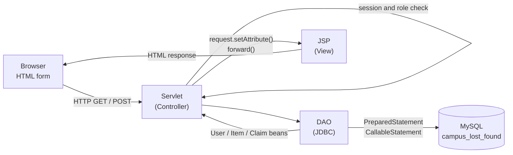
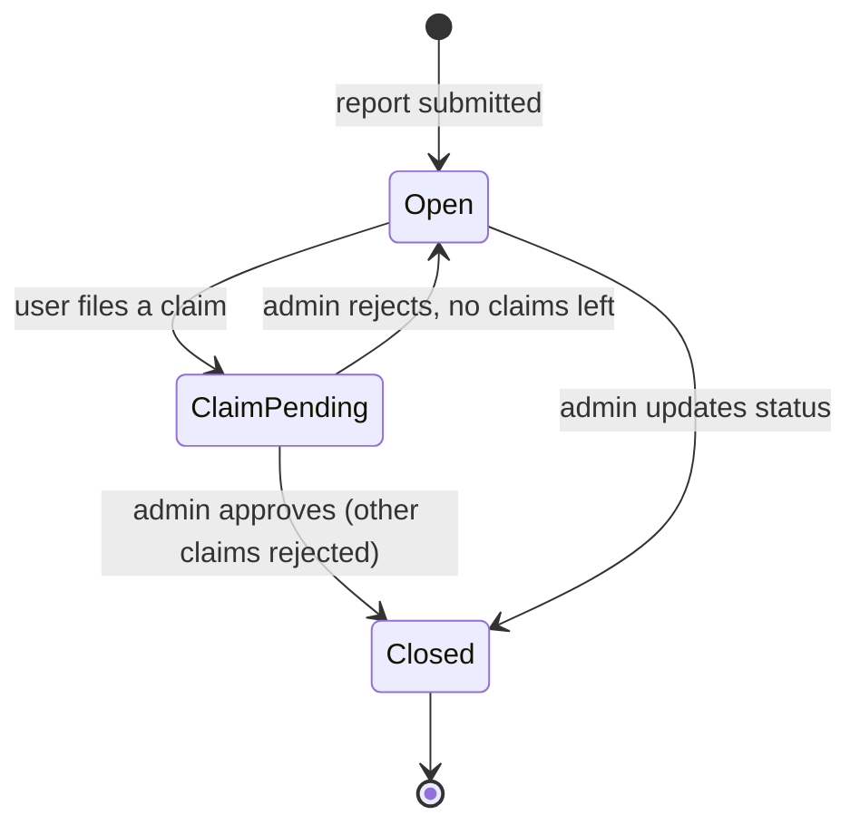
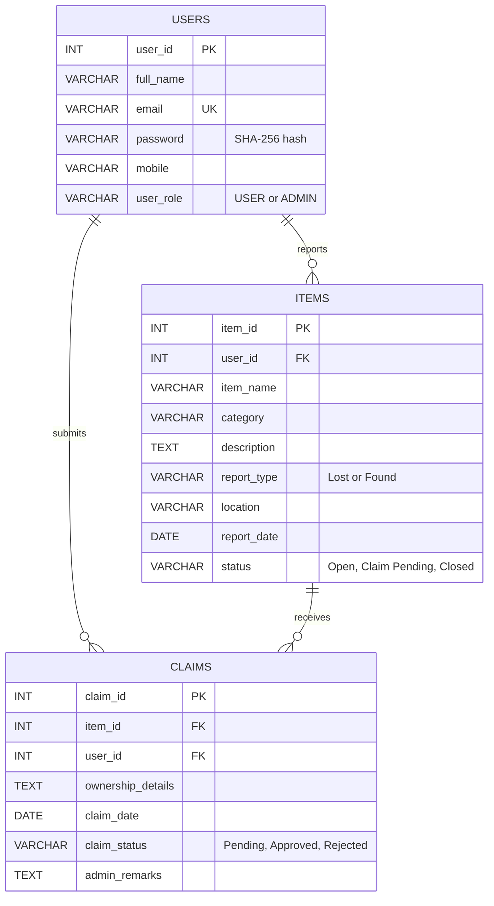

<div align="center">


# Campus Lost &amp; Found Portal

**Design and Development of a Campus Lost-and-Found Management Portal Using Advanced Java**

Advanced Java Programming · Assignment-1 · MCA Semester I · GM University, Davangere

[](#tech-stack)
[](#tech-stack)
[](#tech-stack)
[](#tech-stack)
[](#tech-stack)
[](#architecture)

[About](#about) ·
[Features](#features) ·
[Architecture](#architecture) ·
[Database](#database-design) ·
[Getting started](#getting-started) ·
[Testing](#testing) ·
[Author](#author)

</div>

---

## About

Students, faculty members and visitors often lose belongings on campus, such as identity cards, books, laptops, phones, wallets and keys. People who find these items usually have no proper way to return them. Notice boards, announcements and WhatsApp groups are slow, can't be searched and keep no record.

The **Campus Lost &amp; Found Portal** is a database-driven web application that gives the campus one searchable place for every lost and found report. Registered users report items, search all reports, and claim an item with proof of ownership. An administrator verifies each claim before the item is handed over, updates the recovery status, removes duplicate reports and sees a live summary.

The application follows the **Model-View-Controller (MVC)** architecture:

- HTML forms with JavaScript validation form the front end.
- **Servlets** are the controllers.
- **JSP** pages are the views.
- **JavaBeans** and **DAO** classes form the model.
- **JDBC** connects to a MySQL database.

### Project details

| | |
|---|---|
| **University** | GM University, Davangere |
| **Faculty** | Faculty of Computing &amp; IT |
| **Programme** | Master of Computer Applications (MCA), First Semester |
| **Course** | Advanced Java Programming |
| **Assignment** | Assignment-1 |
| **Guide** | Mr. Rajashekhara G C, Faculty of Computing &amp; IT |
| **Developed by** | [Aniket C Tegginamath](https://github.com/Aniket886) |
| **Academic year** | 2026–27 |

---

## Features

<table>
<tr>
<td width="50%" valign="top">

### User module
- Register and log in securely
- Report **lost** items and **found** items
- Give item name, category, description, location and date
- Search by keyword, category and type
- View full item details
- Submit an ownership claim with proof
- Track the status of claims and the admin's remarks
- View your own reports
- Log out (session invalidation)

</td>
<td width="50%" valign="top">

### Administrator module
- Administrator login with role-based access
- View, search and filter all reports
- Review ownership claims and their evidence
- Approve or reject claims with verification remarks
- Update item recovery status
- Remove inappropriate or duplicate reports
- Dashboard summary of reported and recovered items

</td>
</tr>
<tr>
<td valign="top">

### Item management
- Records of all lost and found items
- Categories: Electronics, Books, Identity Cards, Accessories, Personal Belongings, Others
- Date and location of every loss or find
- Recently reported items on the home page
- Recovered items marked **Closed**

</td>
<td valign="top">

### Ownership claims
- One claim per user per item
- Proof of ownership (minimum 15 characters)
- Claim status: Pending, Approved or Rejected
- Approving a claim closes the item and rejects other pending claims, all in one JDBC transaction

</td>
</tr>
</table>

### Interface

- A clean design built with plain CSS design tokens, with no UI framework.
- Light and dark mode, and a layout that works on phones.
- Every item appears as a lost-and-found tag with a reference number such as `LF-0042`.
- Form errors show inside the form. Every rule is checked again on the server.

---

## Tech stack

| Layer | Technology |
|---|---|
| Front end | HTML5, CSS3, JavaScript (client-side validation) |
| Controller | Jakarta Servlets 6.0 |
| View | JSP 3.1 (directives, scripting elements, standard actions, implicit objects) |
| Model | JavaBeans (`User`, `Item`, `Claim`) and DAO classes |
| Data access | JDBC with MySQL Connector/J 8.4 (Type-4 driver) |
| Database | MySQL 8.x |
| Web server | Apache Tomcat 10.1 or 11.0 |
| IDE / build | Eclipse IDE for Enterprise Java and Web Developers; optional Maven |
| Language | Java 17 |

---

## Architecture

Every request passes through a servlet, which checks the session first. The JSP views live inside `WEB-INF/views`, so a browser can't open them directly.



1. The browser sends an HTTP GET or POST request to a servlet.
2. The servlet checks the session and reads the form parameters.
3. It calls a DAO method, which runs SQL through JDBC.
4. The DAO converts the `ResultSet` into JavaBeans.
5. The servlet stores the beans as request attributes and forwards to a JSP.
6. The JSP reads the beans and returns the HTML response.

### Item and claim workflow



### URL map

| URL | Method | Servlet | Purpose | Access |
|---|---|---|---|---|
| `/` | GET | `index.jsp` → `jsp:forward` | Entry point | All |
| `/register` | POST | `RegisterServlet` | Create account | Guest |
| `/login` | GET / POST | `LoginServlet` | Show form / authenticate | Guest |
| `/home` | GET | `HomeServlet` | Recently reported items | User |
| `/report?type=Lost\|Found` | GET / POST | `ReportItemServlet` | Report form / save | User |
| `/search` | GET | `SearchServlet` | Keyword, category and type search | User |
| `/item?id=n` | GET | `ItemDetailsServlet` | Item details and claim form | User |
| `/claims` | GET / POST | `ClaimServlet` | My claims / submit claim | User |
| `/myReports` | GET | `MyReportsServlet` | My lost and found reports | User |
| `/admin?view=items\|claims` | GET / POST | `AdminServlet` | Dashboard, reports, claim decisions | Admin |
| `/logout` | GET | `LogoutServlet` | End session | User |

---

## Database design

Database **`campus_lost_found`** has three tables, as given in the assignment's suggested design. The script also adds `AUTO_INCREMENT`, `NOT NULL`, `UNIQUE` and foreign-key constraints.



- **Relationships:** `ON DELETE CASCADE` removes an item's claims when the administrator deletes a duplicate report. `UNIQUE (item_id, user_id)` stops a user from claiming the same item twice.
- **Stored procedure:** `sp_item_summary` returns the total, lost, found, closed and pending-claim counts for the admin dashboard. It's called with a `CallableStatement`.

---

## Project structure

```text
CampusLostFound/
├── assets/gmulogo1.png                  University logo (source image)
├── database/campus_lost_found.sql       Creates the database, tables, procedure and sample data
├── deploy/CampusLostFound.war           Ready-to-deploy build
├── pom.xml                              Optional Maven build (run without Eclipse)
├── .classpath  .project  .settings/     Eclipse Dynamic Web Project files
└── src/main/
    ├── java/com/campus/lostfound/
    │   ├── bean/        User, Item, Claim                         (Model: data)
    │   ├── dao/         DBConnection, UserDAO, ItemDAO, ClaimDAO   (Model: JDBC)
    │   ├── controller/  10 servlets                               (Controller)
    │   └── util/        PasswordUtil, SessionUtil, HtmlUtil       (Helpers)
    └── webapp/
        ├── index.jsp  login.jsp  register.html  error.jsp
        ├── includes/    header.jsp  footer.jsp
        ├── css/style.css   js/validate.js   img/
        └── WEB-INF/
            ├── web.xml
            ├── lib/mysql-connector-j-8.4.0.jar
            └── views/   home, search, reportItem, itemDetails,
                         myReports, myClaims, admin/{dashboard, items, claims}
```

---

## Getting started

### Prerequisites

| Software | Version |
|---|---|
| JDK | 17 or later |
| Apache Tomcat | 10.1.x or 11.0.x |
| MySQL Server | 8.x (MySQL Workbench optional) |
| Eclipse | Eclipse IDE for Enterprise Java and Web Developers, 2023 or later |
| Browser | Chrome, Edge or Firefox |

### 1. Create the database

Open `database/campus_lost_found.sql` in MySQL Workbench and run the whole script, or use the command line:

```bash
mysql -u <your-mysql-user> -p < database/campus_lost_found.sql
```

It creates the database, the three tables, the stored procedure and some sample data.

> [!WARNING]
> The script starts with `DROP DATABASE IF EXISTS`, so it deletes any existing portal data.

### 2. Configure the database connection

Open `src/main/java/com/campus/lostfound/dao/DBConnection.java` and set `USER` and `PASSWORD` to your own MySQL login.

> [!IMPORTANT]
> Don't commit your real MySQL password to a public repository.

### 3. Run in Eclipse

1. **File → Import → General → Existing Projects into Workspace**, then select the `CampusLostFound` folder.
2. **Window → Preferences → Server → Runtime Environments → Add** your Apache Tomcat (10.1 or 11.0). Its JRE must be JDK 17 or later.
3. Right-click the project, then **Properties → Targeted Runtimes**, and tick your Tomcat version.
4. Right-click the project, then **Run As → Run on Server**.
5. Open <http://localhost:8080/CampusLostFound/>.

### 4. Deploy as a WAR (without Eclipse)

1. Copy `deploy/CampusLostFound.war` into Tomcat's `webapps` folder.
2. Start Tomcat with `bin/startup.bat` on Windows, or `bin/startup.sh` on Linux and macOS.
3. Open <http://localhost:8080/CampusLostFound/>.

With Maven installed, you can instead run `mvn jetty:run`, or run `mvn clean package` and deploy `target/CampusLostFound.war`.

### 5. Sign in

The SQL script creates one **administrator** account and one **sample student** account. New registrations always get the `USER` role, so nobody can make themselves an administrator from the sign-up form.

| Role | Account |
|---|---|
| Administrator | Seeded by `database/campus_lost_found.sql` |
| Student (sample) | Seeded by `database/campus_lost_found.sql`, or register a new account |

> [!NOTE]
> Login credentials are intentionally not published in this README. They're shared with evaluators separately. Change the seeded passwords before using the portal anywhere other than a local lab machine.

### Using Tomcat 9

Tomcat 9 uses the older `javax.servlet` package. To use it:

1. Replace `jakarta.servlet` with `javax.servlet` in the Java files.
2. Change the `web.xml` header to version 4.0.
3. In `error.jsp`, read `javax.servlet.error.status_code`.

---

## Advanced Java concepts covered

| Requirement | Implementation |
|---|---|
| **A. HTML forms and HTTP** | Registration, login, report, search and claim forms. `validate.js` checks input in the browser. GET for reads (bookmarkable searches) and POST for changes, with Post-Redirect-Get and 403 / 404 / 400 status pages. |
| **B. Java Servlets** | 10 servlets. `LoginServlet` is mapped in `web.xml` to show `init()`, `service()` and `destroy()`, a `ServletConfig` init-param and `load-on-startup`. |
| **C. JSP** | Page and include directives; expressions, scriptlets and declarations, including `jspInit()` / `jspDestroy()`. `<jsp:include>`, `<jsp:forward>`, and all implicit objects, including `exception` in `error.jsp`. |
| **D. JavaBeans and MVC** | Serializable `User`, `Item` and `Claim` beans. Servlet → DAO/Bean → `request.setAttribute()` → JSP on every page. |
| **E. JDBC** | `Connection`, `Statement`, `PreparedStatement`, `CallableStatement` and `ResultSet`. INSERT, SELECT, UPDATE and DELETE. Transactions with `commit()` / `rollback()` for claim submission and decisions. |
| **F. Session management** | `HttpSession` with a 30-minute timeout, and a new session ID after login. A `lastEmail` cookie pre-fills the login form, and `encodeURL()` shows URL rewriting. Admin pages return 403 to other users, and logout calls `invalidate()`. |

### Security

- **Passwords:** stored as SHA-256 hashes.
- **SQL injection:** every user input goes through a `PreparedStatement`.
- **Script injection:** all output is HTML-escaped with `HtmlUtil.esc()`.
- **Hidden views:** JSPs are under `WEB-INF`, so they can only be reached through servlets.
- **Server-side validation:** the server repeats every client-side rule, including the claim proof length, report dates, categories and the allowed status values.

---

## Testing

The application was tested module by module, then end to end, following an item from its report to its recovery. All **27 test cases** in the assignment report pass.

| Area | Cases | What was verified |
|---|---|---|
| User | TC 1–5 | Registration, duplicate email, client validation, valid and invalid login |
| Items | TC 6–8, 11–12 | Lost and found reports, future-date check, item details, invalid ID → 404 |
| Search | TC 9–10 | Keyword search and category filter |
| Claims | TC 13–15 | Claim submission, own-item claim refused, claim status and remarks |
| Admin | TC 16–21 | Dashboard, approve and reject, status update, delete duplicate, filter |
| Session | TC 22–24 | Login required, user → `/admin` gives 403, logout invalidates the session |
| JDBC | TC 25 | Transaction on approval updates the claim, the item and other claims together |
| Security | TC 26–27 | SQL injection in login refused; `<script>` shown as plain text |

### Expected output achieved

| # | Expected output | Status |
|---|---|---|
| 1 | User registration and login | ✅ |
| 2 | Reporting lost and found items | ✅ |
| 3 | Searching for reported belongings | ✅ |
| 4 | Viewing item details | ✅ |
| 5 | Submitting ownership claims | ✅ |
| 6 | Administrator verification of claims | ✅ |
| 7 | Updating item recovery status | ✅ |
| 8 | Database operations using JDBC | ✅ |
| 9 | Session management | ✅ |
| 10 | Integration of Servlets, JSP and JavaBeans using MVC | ✅ |

### Course outcome mapping

| CO | Contribution |
|---|---|
| CO1 | HTML forms with validation; GET and POST request-response communication |
| CO2 | Servlets for item reporting, searching and session management |
| CO3 | Dynamic JSP pages using directives, scripting elements, actions and implicit objects |
| CO4 | Integration of JavaBeans, Servlets and JSP in the MVC architecture |
| CO5 | JDBC connectivity, SQL CRUD operations, stored procedure and transactions |
| CO6 | A complete database-driven web application using Advanced Java technologies |

---

## Troubleshooting

| Symptom | Fix |
|---|---|
| Error page says **Access denied** for user | The MySQL user or password is wrong. Update `DBConnection.java`. |
| **Unknown database** | Run `database/campus_lost_found.sql`. |
| **Communications link failure** / connection refused | Start the MySQL service (Windows: Services → MySQL80 → Start). |
| Red marks on `jakarta.servlet` imports | Project → Properties → Targeted Runtimes → tick your Tomcat version. |
| Tomcat fails to start | Check the Console for the first error. Common causes: port 8080 is in use, the JRE is older than 17, or an old Tomcat is still running. |
| Pages show no styling after an update | In Eclipse, Project → Clean, then Server → Clean, and run again. |

---

## Future enhancements

- Upload photographs of items for easier identification
- E-mail or SMS alerts when a matching item is reported
- Automatic matching of lost and found reports
- QR-code stickers for ID cards and laptops that link to the owner
- Password reset by OTP, and a JNDI connection pool
- A mobile app that uses the same database through REST services

---

## References

1. Uttam K. Roy, *Web Technologies*, Oxford University Press, 2011.
2. Marty Hall and Larry Brown, *Core Servlets and JavaServer Pages*, 2nd ed., Pearson, 2003.
3. Mike Murach and Michael Urban, *Murach's Java Servlets and JSP*, 3rd ed., 2014.
4. Herbert Schildt, *Java: The Complete Reference*, 12th ed., McGraw Hill, 2022.
5. Jakarta Servlet 6.0 and Jakarta Server Pages 3.1 Specifications, Eclipse Foundation.
6. MySQL 8.0 Reference Manual, Oracle Corporation.

---

## Author

<div align="center">


**Aniket C Tegginamath**<br>
MCA, Faculty of Computing &amp; IT, GM University, Davangere

[](https://github.com/Aniket886)

Submitted under the guidance of **Mr. Rajashekhara G C** for Advanced Java Programming, Assignment-1.<br>
<sub>This project was built for academic purposes.</sub>

</div>
